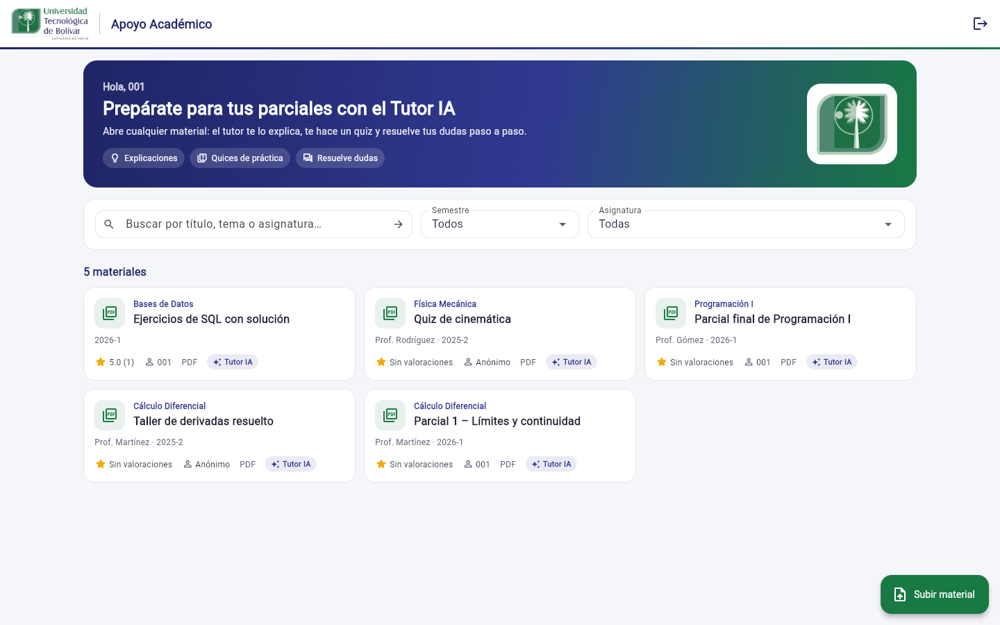

# Plataforma de Apoyo Académico · UTB



Proyecto de aula — curso de Ingeniería de Software, Universidad Tecnológica de Bolívar.
Equipo: **Jaime Mochen** y **Cristian David Cardeño Gulloso**.

Plataforma web que permite a los estudiantes universitarios centralizar, organizar y
consultar material de estudio (parciales anteriores, talleres y otros recursos),
clasificado por asignatura, semestre y tema, para facilitar la práctica autónoma y el
refuerzo de conocimientos antes de las evaluaciones.

**Nuevo: Tutor IA.** Cada material tiene un tutor con inteligencia artificial (Claude, de
Anthropic) que lee el PDF o la imagen y **explica** sus temas, con pista y solución paso a
paso de los ejercicios clave; genera un **quiz** de práctica con retroalimentación, y
**responde dudas** en un chat. Ver [`docs/ia/Tutor_IA.md`](docs/ia/Tutor_IA.md).

La interfaz usa los colores institucionales y el logosímbolo del Manual de Identidad
Corporativa de la UTB (verde Pantone 277-2C y azul Pantone 184-1C).

> 📄 El documento completo del proyecto —descripción del problema, interesados, técnicas
> de elicitación, requerimientos, priorización y validación del modelado— está en
> [`docs/Avance_de_proyecto_de_aula_Plataforma_de_Apoyo_Academico.pdf`](docs/Avance_de_proyecto_de_aula_Plataforma_de_Apoyo_Academico.pdf).

## Estado de este repositorio

Los 13 requerimientos funcionales del documento (RF-01 a RF-13) y los 3 del Tutor IA
(RF-14 a RF-16) están implementados en el backend y en el frontend:

- **Backend:** pruebas automáticas que recorren los criterios de aceptación contra un
  PostgreSQL real (`npm run test:e2e`), más pruebas rápidas sin base de datos (`npm test`).
- **Frontend:** `flutter analyze` sin observaciones, pruebas de widgets (`flutter test`,
  incluida la vista a 360 px de ancho para RNF-03) y `flutter build web` compila.

Además, cada criterio de aceptación de RF-01 a RF-13 y de RNF-01, 03, 04, 05 y 07 se
verificó a mano en la aplicación (navegador de escritorio y vista móvil de 360 px), y esas
tarjetas del [tablero](tablero.html) están en «Hecho». Quedan pendientes RNF-02 (medir
tiempos de búsqueda) y RNF-06 (disponibilidad, que requiere desplegar la plataforma).

La validación con estudiantes está pendiente. Un recorrido simulado con IA (no fue una
sesión con estudiantes) anticipó siete problemas de uso, H-01 a H-07, que ya están
corregidos y cubiertos por pruebas automáticas. El plan de la sesión con estudiantes está en
[`docs/validacion/`](docs/validacion/Validacion_con_estudiantes.md).

**Importante para el equipo:** a partir de este punto, el historial de commits debe
reflejar el trabajo real del equipo (confirmaciones claras y frecuentes, como pide el
enunciado de la actividad) — no se generaron commits simulados con fechas o mensajes
ficticios.

## Arquitectura

```
Estudiante / Administrador
        │  HTTPS
        ▼
 Aplicación Flutter Web  ───►  Backend API (Node.js + Express)  ───►  PostgreSQL
                                          │
                                          ├──► Almacenamiento de archivos (local en
                                          │    desarrollo; /uploads en el backend)
                                          │
                                          └──► API de Claude (Anthropic): Tutor IA
```

Ver los diagramas completos en [`docs/diagramas/`](docs/diagramas/) (casos de uso,
clases, secuencia, actividades, componentes y despliegue — los dos primeros ya
actualizados con los hallazgos de la sección 8 del documento).

### Modelo de datos

`Usuario` (Estudiante / Administrador) — `Asignatura` — `Material` — `Valoracion` —
`Reporte`. El esquema SQL completo, con los mismos nombres y relaciones del diagrama de
clases, está en [`backend/src/db/schema.sql`](backend/src/db/schema.sql).

## Requerimientos cubiertos

| ID | Requerimiento | API | Pantalla |
|----|----------------|-----|----------|
| RF-01 | Registro de usuario | `POST /api/auth/registro` | Registro |
| RF-02 | Inicio / cierre de sesión (JWT) | `POST /api/auth/login`, `GET /api/auth/perfil` | Inicio de sesión |
| RF-03 | Búsqueda de material por asignatura | `GET /api/materiales?asignatura_id=` | Principal |
| RF-04 | Filtro por semestre / tema | `GET /api/materiales?semestre=&q=` | Principal |
| RF-05 | Visualizar y descargar material | `GET /api/materiales/:id`, `/uploads/...` | Ficha del material |
| RF-06 | Carga de material por estudiantes | `POST /api/materiales` | Botón «Subir material» |
| RF-07 | Carga anónima | campo `es_anonimo` (oculta el autor en las respuestas) | Botón «Subir material» |
| RF-08 | Valoración y comentarios | `POST/GET /api/materiales/:id/valoraciones` | Ficha del material |
| RF-09 | Reporte de contenido | `POST /api/materiales/:id/reportes` | Ficha del material |
| RF-10 | Revisión de reportes | `GET/PATCH /api/reportes` (solo administrador) | Administración › Revisar reportes |
| RF-11 | Metadatos de vigencia (profesor, periodo) | columnas `profesor`, `periodo_academico` | Subir / editar material |
| RF-12 | Gestión de material (admin) | `PUT/DELETE /api/materiales/:id` | Administración › Gestionar material |
| RF-13 | Gestión de usuarios / asignaturas | `GET/POST/PUT /api/usuarios`, `GET/POST/PUT /api/asignaturas` | Administración › Usuarios / Asignaturas |
| RNF-01 | Usabilidad en la carga | carga en 3 pasos: botón, formulario, «Subir» | Principal |
| RNF-03 | Compatibilidad móvil | filtros que se apilan en pantallas angostas | Todas |
| RNF-04 | Seguridad (contraseña cifrada, rutas por rol) | `bcryptjs` + middleware `requiereRol` | — |
| RNF-05 | Confiabilidad del contenido | `calificacion_promedio`, `reportes_pendientes`, estado | Tarjeta y ficha del material |
| RNF-07 | Acceso gratuito | sin flujo de pago en ninguna ruta | — |
| RF-14 | Explicación del material con IA | `POST /api/materiales/:id/ia/explicacion` | Ficha › Tutor IA › Explicación |
| RF-15 | Práctica con preguntas generadas por IA | `POST /api/materiales/:id/ia/practica` | Ficha › Tutor IA › Practicar |
| RF-16 | Preguntas al Tutor IA | `POST /api/materiales/:id/ia/preguntas` | Ficha › Tutor IA › Preguntar |
| RNF-08 | Transparencia y uso responsable de la IA | aviso «Generado con IA», `GET /api/ia/estado` | Panel Tutor IA |

Pendientes: **RNF-02** (medir que el 95 % de las búsquedas responda en menos de 3 s con
datos reales) y **RNF-06** (disponibilidad del 99 %, que depende del despliegue).

**Notas de diseño (RF-13):**

- Una cuenta desactivada no puede iniciar sesión, y al recargar la página su sesión
  guardada deja de ser válida. Como la API usa JWT sin estado, un token ya emitido sigue
  funcionando hasta que vence (`JWT_EXPIRES_IN`, 8 h por defecto); lo mismo ocurre con un
  cambio de rol.
- Una asignatura desactivada deja de aparecer en el buscador y no admite material nuevo,
  pero su material existente se conserva.
- El administrador no puede desactivarse ni quitarse el rol a sí mismo.

## Backend (Node.js + Express + PostgreSQL)

Requiere Node.js 18 o superior y PostgreSQL 13 o superior.

```bash
cd backend
cp .env.example .env        # complete DB_USER, DB_PASSWORD, JWT_SECRET, etc.
npm install
npm run migrate             # aplica backend/src/db/schema.sql (se puede repetir sin riesgo)
npm run crear-admin -- "Nombre Apellido" correo@ejemplo.com "contraseña"
npm run datos-prueba        # opcional: asignaturas, estudiantes y materiales del informe de pruebas
npm run dev                 # http://localhost:4000
```

**Tutor IA.** Cree una clave en <https://platform.claude.com> (API Keys) y péguela en
`backend/.env` como `ANTHROPIC_API_KEY=sk-ant-...`; luego reinicie el backend. La clave
nunca se sube a GitHub (`.env` está en `.gitignore`). Sin clave, la plataforma funciona
igual y el panel indica que el Tutor IA no está configurado. Detalles, costo y reglas
R-10 a R-13 en [`docs/ia/Tutor_IA.md`](docs/ia/Tutor_IA.md).

El registro público siempre crea estudiantes; `npm run crear-admin` crea el primer
administrador (o promueve una cuenta existente si el correo ya está registrado). Desde
ahí, el administrador gestiona los demás usuarios y las asignaturas en la aplicación.

¿No tiene PostgreSQL instalado? Con Docker basta un contenedor de desarrollo:

```bash
docker run -d --name apoyo-academico-db -p 5432:5432 \
  -e POSTGRES_USER=apoyo_academico -e POSTGRES_PASSWORD=cambiar-esta-clave \
  -e POSTGRES_DB=apoyo_academico postgres:16-alpine
```

Si el puerto 5432 ya está ocupado (otro PostgreSQL en el equipo), use otro puerto, por
ejemplo `-p 5435:5432`, y ponga `DB_PORT=5435` en `backend/.env`. Los comandos `npm`
se ejecutan siempre dentro de `backend/`.

Verificación rápida:

```bash
curl http://localhost:4000/api/salud
# {"estado":"ok","servicio":"plataforma-apoyo-academico-api"}
```

### Pruebas del backend

```bash
npm test            # sin base de datos: control de acceso por rol y validaciones
npm run test:e2e    # contra PostgreSQL: recorre los criterios de aceptación de RF-01 a RF-16
```

Las pruebas del Tutor IA usan un cliente de IA falso: no llaman a la API real ni gastan
crédito.

`npm run test:e2e` usa la base configurada en `.env`, pero trabaja dentro de un esquema
temporal que se elimina al terminar, así que no modifica los datos de desarrollo.

## Frontend (Flutter Web)

Probado con Flutter 3.24 (Dart 3.5) y 3.47.7 (Dart 3.13). El `pubspec.lock` del
repositorio corresponde a Flutter 3.47; con Flutter 3.24, `flutter pub get` lo vuelve a
resolver.

```bash
cd frontend
flutter pub get
flutter run -d chrome --dart-define=API_BASE_URL=http://localhost:4000
# Si no tiene Chrome instalado, use Edge: flutter run -d edge ...
```

Pruebas y compilación:

```bash
flutter analyze     # análisis estático (reglas de flutter_lints)
flutter test        # pruebas de widgets
flutter build web --dart-define=API_BASE_URL=https://su-backend.example.com
```

Pantallas incluidas: inicio de sesión, registro, búsqueda/listado de material con filtros
por semestre, asignatura y tema (con subida desde un botón flotante), detalle de material
(descargar, valorar, reportar y Tutor IA) y, para el rol administrador (menú «Administración»):
gestionar material, revisar reportes, asignaturas y usuarios.

## Convención de commits

```
tipo(alcance): descripción breve

feat(material): agregar carga anónima de material
fix(auth): corregir validación de contraseña
docs(readme): actualizar instrucciones de despliegue
```

Tipos sugeridos: `feat`, `fix`, `docs`, `refactor`, `test`, `chore`.

## Estructura del repositorio

```
plataforma-apoyo-academico/
├── docs/                    # documento del proyecto, diagramas UML y docs/ia/ (Tutor IA)
├── backend/                 # API REST (Node.js + Express + PostgreSQL)
│   ├── src/
│   │   ├── config/          # conexión a la base de datos
│   │   ├── db/              # schema.sql, migración y creación del primer administrador
│   │   ├── middleware/      # autenticación, roles, subida de archivos, errores
│   │   ├── controllers/     # lógica de cada recurso (auth, materiales, ia, ...)
│   │   ├── services/        # tutorIa.js: conexión con la API de Claude
│   │   └── routes/          # definición de endpoints
│   └── test/                # pruebas de la API (npm test, npm run test:e2e)
├── frontend/                # cliente Flutter Web
│   ├── lib/
│   │   ├── config/          # URL base de la API
│   │   ├── models/          # Usuario, Asignatura, Material, Valoracion, Reporte
│   │   ├── services/        # cliente HTTP hacia el backend
│   │   ├── state/           # sesión (usuario/token) con Provider
│   │   ├── theme/           # colores institucionales de la UTB
│   │   ├── screens/         # pantallas de la aplicación
│   │   └── widgets/         # componentes reutilizables (panel del Tutor IA, logo UTB)
│   ├── assets/utb/          # logosímbolo de la UTB
│   └── test/                # pruebas de widgets (flutter test)
└── tablero.html             # tablero Kanban del proyecto (sección 9.2)
```

## Próximos pasos sugeridos

1. Cada integrante levanta el backend con su PostgreSQL (local o Docker) y el frontend
   con `flutter run -d chrome`, y verifica en la aplicación el criterio de aceptación de
   cada requerimiento; luego mueve su tarjeta a «Hecho» en el tablero.
2. Probar la aplicación en un celular real (RNF-03) y medir los tiempos de búsqueda con
   datos de prueba realistas (RNF-02).
3. Elegir dónde desplegar la plataforma (RNF-06) y definir `JWT_SECRET` propio en ese
   entorno (con `NODE_ENV=production` la API no arranca sin él).
4. Habilitar el acceso del docente al repositorio si se mantiene privado.
5. Configurar la clave del Tutor IA y probarlo con material real: revisar con un docente de
   cada asignatura que las explicaciones sean correctas, y con estudiantes que les sirvan
   (RF-14 a RF-16, RNF-08). Registrar el costo y el tiempo de respuesta.
