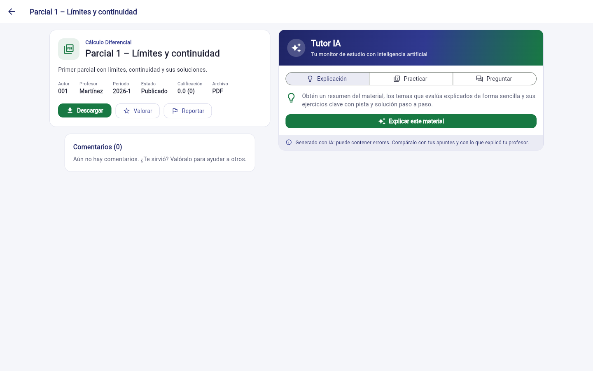

# Tutor IA: inteligencia artificial en la Plataforma de Apoyo Académico

Este documento describe la funcionalidad de inteligencia artificial que se agregó a la
plataforma: por qué se eligió, qué requerimientos nuevos cubre, cómo funciona y cómo se
configura. Complementa el documento del proyecto (secciones 6 y 7) y el informe de pruebas
del MVP.

## 1. El problema que resuelve

La plataforma ya permite encontrar parciales, quices y talleres de semestres anteriores
(RF-03 a RF-05). Pero un parcial sin explicación sirve poco: el estudiante ve el enunciado
y, si tiene suerte, la respuesta, sin entender cómo se llega a ella. Además, el docente del
curso pidió incorporar inteligencia artificial al proyecto. Falta confirmar con estudiantes
que esta función responde a una necesidad real (sección 6).

El **Tutor IA** convierte cada material en una sesión de estudio guiada. El objetivo no es
dar respuestas para copiar, sino que el estudiante entienda el tema antes de su evaluación.

## 2. Qué hace

Cada ficha de material tiene un panel **Tutor IA** con tres pestañas:

| Pestaña | Qué hace | Requerimiento |
|---|---|---|
| **Explicación** | Resume el material, explica de forma sencilla los temas que evalúa, con un ejemplo, y presenta sus ejercicios clave. La **pista** y la **solución paso a paso** quedan ocultas hasta que el estudiante las pide, para que primero intente resolverlo. Cierra con consejos para el examen. | RF-14 |
| **Practicar** | Genera un quiz de 5 preguntas de opción múltiple sobre los mismos temas, sin copiar los ejercicios del material. Al responder muestra si acertó, cuál era la correcta y por qué. | RF-15 |
| **Preguntar** | Chat sobre el material: «explícame el punto 2», «¿qué temas debo repasar?», «dame un ejercicio parecido». Sugiere preguntas para empezar. | RF-16 |

La IA **lee el archivo**: los PDF y las imágenes (PNG o JPG) se envían al modelo, que
entiende texto, fórmulas, tablas y escritura escaneada. De los archivos Word y ZIP solo conoce
el título y la descripción, y la aplicación lo avisa.



## 3. Requerimientos nuevos

### Funcionales

| ID | Requerimiento | Criterio de aceptación | Prioridad (MoSCoW) |
|---|---|---|---|
| RF-14 | Explicación del material con IA | Desde la ficha, el estudiante obtiene un resumen, los temas explicados y los ejercicios clave con pista y solución ocultas hasta que las pida. | Importante |
| RF-15 | Práctica con preguntas generadas por IA | El estudiante responde un quiz de opción múltiple sobre el material y, en cada pregunta, ve si acertó y la explicación. | Importante |
| RF-16 | Preguntas al Tutor IA | El estudiante hace preguntas sobre el material y el tutor responde teniendo en cuenta la conversación. | Importante |

### No funcional

| ID | Requerimiento | Criterio de aceptación |
|---|---|---|
| RNF-08 | Transparencia y uso responsable de la IA | Toda respuesta de la IA se muestra con el aviso «Generado con IA: puede contener errores». La aplicación avisa cuando la IA no pudo leer el archivo. Si el servidor no tiene la IA configurada, el resto de la plataforma funciona igual. |

### Reglas de negocio

| ID | Regla | Por qué |
|---|---|---|
| R-10 | La primera explicación y el primer quiz que se generan para un material se guardan y se reutilizan para todos los estudiantes. Se puede pedir una nueva con «Explicar de otra forma» o «Nuevas preguntas». | La segunda consulta es inmediata y no tiene costo. |
| R-11 | Las conversaciones del chat no se guardan en el servidor: la aplicación envía el historial en cada pregunta. | Privacidad: las dudas de cada estudiante no quedan registradas. |
| R-12 | De los archivos Word y ZIP, o de los de más de 20 MB, la IA solo recibe el título, la descripción y los metadatos. | El modelo lee PDF e imágenes; cada petición admite hasta 32 MB. |
| R-13 | Cada usuario puede hacer hasta 20 consultas nuevas a la IA por hora (configurable con `IA_LIMITE_POR_HORA`). Las respuestas guardadas no cuentan. | Controlar el costo de la API. |
| R-08 (ampliada) | El nombre de quien subió un material anónimo tampoco se envía a la IA. | Mantener el anonimato de RF-07. |

## 4. Cómo funciona

```
Aplicación Flutter ──► Backend (Node.js) ──► API de Claude (Anthropic)
   panel Tutor IA       ia.controller.js        lee el PDF o la imagen
                        services/tutorIa.js     y responde
                              │
                              └──► PostgreSQL: tabla ia_contenidos (R-10)
```

1. El estudiante pulsa, por ejemplo, «Explicar este material».
2. La aplicación llama a `POST /api/materiales/:id/ia/explicacion`.
3. El backend revisa si ya hay una explicación guardada (R-10). Si la hay, la devuelve.
4. Si no, verifica el límite por hora (R-13), lee el archivo del disco y lo envía a la API de
   Claude junto con los datos del material y las instrucciones del tutor.
5. La API responde con un JSON que sigue un esquema fijo (resumen, temas, ejercicios,
   consejos), así que la aplicación siempre lo puede dibujar como tarjetas.
6. El backend guarda la respuesta y la devuelve.

| Ruta | Uso |
|---|---|
| `GET /api/ia/estado` | Si el servidor tiene la IA configurada |
| `POST /api/materiales/:id/ia/explicacion` | RF-14 (`{ "nueva": true }` para regenerar) |
| `POST /api/materiales/:id/ia/practica` | RF-15 (`{ "nueva": true }` para regenerar) |
| `POST /api/materiales/:id/ia/preguntas` | RF-16 (`{ "pregunta": "...", "historial": [...] }`) |

**Decisiones de diseño**

- **Modelo:** Claude Opus 5.5 (`claude-opus-5-5`) con esfuerzo `medium`. Se cambia con
  `IA_MODELO` e `IA_ESFUERZO` en `backend/.env`.
- **Instrucciones del tutor:** explicar en español sencillo, mostrar el razonamiento de cada
  paso, señalar errores comunes y errores del propio material, y decir «no sé» antes que
  inventar. Están en `backend/src/services/tutorIa.js`.
- **Salidas estructuradas:** la explicación y el quiz usan un esquema JSON, para que la
  aplicación no dependa de cómo el modelo redacte la respuesta.
- **Caché de la API:** el archivo se marca para la caché de la API, así que en una
  conversación del chat el documento se cobra completo una sola vez.
- **Respaldo:** si el modelo declina una petición, la API la reintenta con el modelo de
  respaldo que recomienda Anthropic (`fallbacks: "default"`).
- **Errores claros:** sin clave, clave inválida, límite alcanzado o material inexistente
  devuelven un mensaje en español que la aplicación muestra tal cual.

## 5. Cómo configurarlo

1. Crear una cuenta en <https://platform.claude.com> y cargar crédito (la API se paga por
   uso).
2. En **API Keys**, crear una clave. Empieza por `sk-ant-`. **No se sube a GitHub.**
3. Pegarla en `backend/.env`:

   ```
   ANTHROPIC_API_KEY=sk-ant-...
   ```

4. Reiniciar el backend (`npm run dev`) y aplicar el esquema (`npm run migrate`), que crea la
   tabla `ia_contenidos`.

Sin clave, la plataforma funciona igual y el panel muestra «El Tutor IA no está configurado
en este servidor».

**Costo aproximado.** La API cobra por *tokens* (fragmentos de texto): con Claude Opus 5.5,
4 USD por millón de tokens de entrada y 20 USD por millón de salida. Un parcial de 5 páginas
ocupa del orden de 10.000 tokens, así que una explicación cuesta unos pocos centavos de dólar
y, por la regla R-10, se paga una sola vez por material. Es una estimación: el costo real
depende del largo de cada archivo y de cada respuesta, y se puede revisar en la consola de
Anthropic.

## 6. Pruebas

| Prueba | Qué verifica |
|---|---|
| `npm test` | Sin token no se usa el Tutor IA; la pregunta y el historial se validan; la aplicación puede consultar el estado. |
| `npm run test:e2e` | Con un cliente de IA falso (sin llamar a Internet ni gastar crédito): el PDF se envía como documento, el autor anónimo no se envía, la explicación se guarda y se reutiliza (R-10), el quiz descarta preguntas inválidas, el chat envía el historial, una negativa del modelo responde 422 y el límite por hora responde 429 (R-13). |
| `flutter test` | El panel muestra el aviso sin clave; la solución queda oculta hasta pedirla; el quiz marca la respuesta; el chat envía el historial; la ficha con el tutor cabe en 360 px (RNF-03). |

**Pendiente:** probar el Tutor IA con la API real y con material real, revisar la calidad de
las explicaciones con estudiantes y con un docente de cada asignatura, y medir el costo y el
tiempo de respuesta. Las pruebas automáticas usan una IA simulada: verifican el
funcionamiento de la plataforma, no la calidad de lo que responde el modelo.

## 7. Aporte para la UTB

- **Monitoría disponible siempre:** el tutor responde a cualquier hora, también la noche
  antes del parcial, cuando no hay monitores ni profesores disponibles.
- **Aprender, no copiar:** la pista va antes que la solución, y el quiz obliga a aplicar lo
  aprendido.
- **Aprovecha lo que ya existe:** cada parcial que suben los estudiantes se vuelve material
  explicado, sin trabajo adicional para los docentes.
- **Inclusión:** ayuda en especial a quien no puede pagar clases particulares ni asistir a
  monitorías en horario fijo.
- **Uso responsable:** las respuestas se identifican como generadas por IA y las dudas de
  los estudiantes no se guardan.
