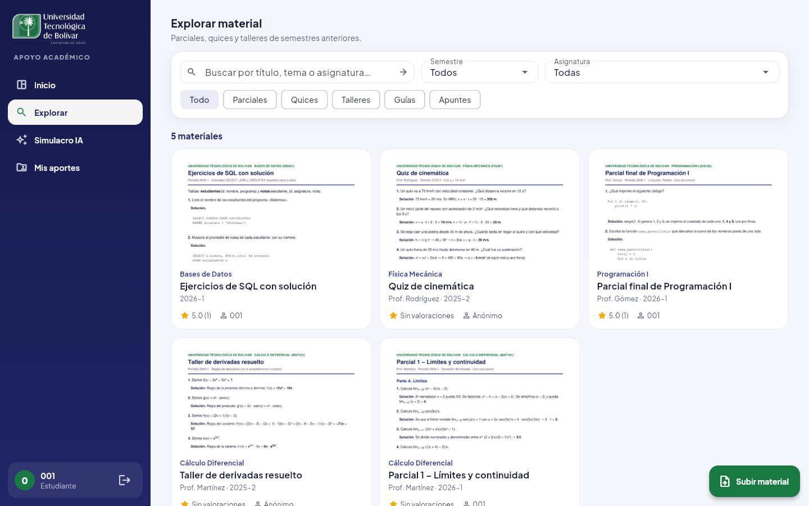

# Tutor IA: inteligencia artificial en la Plataforma de Apoyo Académico

Este documento describe las funciones de inteligencia artificial de la plataforma: por qué
se agregaron, qué requerimientos nuevos cubren, cómo funcionan y cómo se configuran.
Complementa el documento del proyecto (secciones 6 y 7) y el informe de pruebas del MVP.

## 1. El problema que resuelve

La plataforma permite encontrar parciales, quices y talleres de semestres anteriores
(RF-03 a RF-05). Pero tenía dos problemas:

1. **Un parcial sin explicación sirve poco.** El estudiante ve el enunciado y, con suerte,
   la respuesta, pero no cómo se llega a ella.
2. **Una plataforma abierta se llena de archivos que no sirven.** Cualquiera puede subir
   un PDF equivocado, de otra asignatura o sin relación con el estudio, y revisar todo a
   mano exige que un administrador esté pendiente siempre.

Además, el docente del curso pidió incorporar inteligencia artificial al proyecto. Falta
confirmar con estudiantes que estas funciones responden a una necesidad real (sección 7).

## 2. Qué hace

| Función | Qué hace | Requerimiento |
|---|---|---|
| **Revisión al subir** | Antes de publicar un archivo, la IA revisa si es material académico, si corresponde a la asignatura y al título, si se puede leer, si es inapropiado y si muestra datos personales de otras personas. Lo aprueba, lo deja pendiente para un administrador o lo rechaza con un motivo y qué corregir. También identifica el tipo (parcial, quiz, taller...), los temas y la dificultad. | RF-17 |
| **Vista previa** | Cada material muestra la primera página del PDF, o la imagen, en las tarjetas y en la ficha. | RF-19 |
| **Explicación** | Resumen, temas explicados con un ejemplo y ejercicios clave con **pista** y **solución paso a paso** ocultas hasta que el estudiante las pide. | RF-14 |
| **Practicar** | Quiz de 5 preguntas de opción múltiple sobre el material, con la explicación de cada respuesta. | RF-15 |
| **Preguntar** | Chat sobre el material, con preguntas sugeridas para empezar. | RF-16 |
| **Simulacro de parcial** | Examen de práctica de 5, 10 o 15 preguntas con los temas que más se repiten en el material de una asignatura. Al terminar muestra la nota (sobre 5,0) y los temas para repasar. | RF-18 |

La IA **lee el archivo**: los PDF y las imágenes se envían al modelo, que entiende texto,
fórmulas, tablas y escritura escaneada; de los Word se envía su texto. De los ZIP solo
conoce el título y la descripción, y la aplicación lo avisa.



## 3. Requerimientos nuevos

### Funcionales

| ID | Requerimiento | Criterio de aceptación | Prioridad (MoSCoW) |
|---|---|---|---|
| RF-14 | Explicación del material con IA | Desde la ficha, el estudiante obtiene un resumen, los temas explicados y los ejercicios clave con pista y solución ocultas hasta que las pida. | Importante |
| RF-15 | Práctica con preguntas generadas por IA | El estudiante responde un quiz de opción múltiple sobre el material y, en cada pregunta, ve si acertó y la explicación. | Importante |
| RF-16 | Preguntas al Tutor IA | El estudiante hace preguntas sobre el material y el tutor responde teniendo en cuenta la conversación. | Importante |
| RF-17 | Revisión automática del material al subirlo | Un archivo que no es académico, no corresponde a la asignatura, no se puede leer o es inapropiado no se publica, y quien lo subió ve el motivo. El material con dudas queda pendiente para el administrador. | Importante |
| RF-18 | Simulacro de parcial con IA | El estudiante elige una asignatura y responde un examen de práctica basado en su material publicado, con nota y temas para repasar. | Deseable |
| RF-19 | Vista previa del material | Cada material con PDF o imagen muestra su primera página en la lista y en la ficha. | Importante |

### No funcional

| ID | Requerimiento | Criterio de aceptación |
|---|---|---|
| RNF-08 | Transparencia y uso responsable de la IA | Toda respuesta de la IA lleva el aviso «Generado con IA: puede contener errores»; la aplicación avisa cuando la IA no pudo leer el archivo; si el servidor no tiene IA configurada, el resto de la plataforma funciona igual. |

### Reglas de negocio

| ID | Regla | Por qué |
|---|---|---|
| R-10 | La primera explicación y el primer quiz de cada material se guardan y se reutilizan para todos los estudiantes; se puede pedir uno nuevo. | La segunda consulta es inmediata y no gasta cuota de la IA. |
| R-11 | Las conversaciones del chat no se guardan en el servidor. | Privacidad de las dudas de cada estudiante. |
| R-12 | De los ZIP y de los archivos de más de 20 MB la IA solo recibe el título, la descripción y los metadatos. | El modelo lee PDF, imágenes y texto. |
| R-13 | Cada usuario puede hacer hasta 20 consultas nuevas a la IA por hora (configurable). Las respuestas guardadas no cuentan. | No agotar la cuota gratuita y controlar el costo. |
| R-14 | El veredicto de la revisión lo decide el servidor con reglas fijas a partir de los criterios que evalúa la IA: no académico, otra asignatura, ilegible o inapropiado → rechazado; título que no corresponde, datos personales o dudas → pendiente; si la IA falla, pendiente. | Que una respuesta inconsistente del modelo no publique algo que no debe, y que ningún material se pierda por una falla de la IA. |
| R-15 | El material pendiente solo lo ven su autor y el administrador. Sin IA configurada, el material se publica directamente, como antes. | Que la comunidad solo vea material revisado. |
| R-08 (ampliada) | El nombre de quien subió un material anónimo tampoco se envía a la IA. | Mantener el anonimato de RF-07. |

## 4. Cómo funciona

```
Aplicación Flutter ──► Backend (Node.js) ──► Proveedor de IA
                        services/tutorIa.js      Gemini (gratuito, por defecto)
                        services/proveedoresIa.js   o Claude (de pago, opcional)
                        services/miniaturas.js   (vista previa: pdf.js + sharp)
                              │
                              └──► PostgreSQL: materiales.revision_ia,
                                   materiales.miniatura_url, ia_contenidos
```

**Al subir un material (RF-17, RF-19):**

1. El estudiante elige el archivo; si es una imagen, ve su vista previa de inmediato.
2. El backend envía el archivo, el título y la asignatura a la IA, con instrucciones de
   revisor y un esquema JSON fijo con los criterios.
3. Con esos criterios, el servidor decide el veredicto (R-14). Si es «rechazado», borra el
   archivo y responde 422 con el motivo; si es «dudoso», guarda el material como
   «pendiente»; si es «aprobado», lo publica.
4. Crea la vista previa (primera página del PDF o la imagen, en JPG de 600 px).
5. La aplicación muestra el resultado: los criterios que revisó la IA, el tipo, los temas y
   la vista previa, o el motivo del rechazo con la opción de corregir y reintentar.

| Ruta | Uso |
|---|---|
| `GET /api/ia/estado` | Si el servidor tiene la IA configurada y qué modelo usa |
| `POST /api/materiales` | Subida con revisión (RF-17) y vista previa (RF-19) |
| `GET /api/materiales?mios=true&tipo=parcial` | «Mis aportes» y filtro por tipo |
| `POST /api/materiales/:id/ia/explicacion` | RF-14 (`{ "nueva": true }` para regenerar) |
| `POST /api/materiales/:id/ia/practica` | RF-15 (`{ "nueva": true }` para regenerar) |
| `POST /api/materiales/:id/ia/preguntas` | RF-16 (`{ "pregunta": "...", "historial": [...] }`) |
| `POST /api/asignaturas/:id/ia/simulacro` | RF-18 (`{ "preguntas": 5 \| 10 \| 15 }`) |

**Decisiones de diseño**

- **IA gratuita por defecto:** Google Gemini (`gemini-3.8-flash`) tiene un nivel gratuito
  con límites de uso. El proveedor se cambia con `IA_PROVEEDOR` en `backend/.env`; Claude
  queda como opción de pago.
- **Proveedores intercambiables:** `services/proveedoresIa.js` traduce los mismos mensajes
  a cada API, así el resto del código no depende de un proveedor.
- **Salidas estructuradas:** la revisión, la explicación, el quiz y el simulacro usan un
  esquema JSON, para que la aplicación no dependa de cómo redacte el modelo.
- **Errores claros:** sin clave, clave inválida, límite gratuito alcanzado o material
  inexistente devuelven un mensaje en español que la aplicación muestra tal cual.

## 5. Cómo configurarlo (gratis)

1. Entrar a <https://aistudio.google.com/apikey> con una cuenta de Google y crear una clave
   («Create API key»). No pide tarjeta de crédito.
2. Pegarla en `backend/.env`:

   ```
   IA_PROVEEDOR=gemini
   GEMINI_API_KEY=su-clave
   ```

3. Reiniciar el backend (`npm run dev`) y aplicar el esquema (`npm run migrate`).
4. Opcional: `npm run datos-prueba` revisa con la IA los 5 materiales de prueba.

**Importante sobre el nivel gratuito:** Google puede usar el contenido que se envía para
mejorar sus productos, y el nivel gratuito tiene límites de solicitudes por minuto y por
día. Para una plataforma con datos sensibles o mucho uso, conviene el nivel de pago (de
Gemini o de Claude). La plataforma no envía a la IA el nombre de los estudiantes, pero sí
el archivo que suben.

Sin clave, la plataforma funciona igual: el panel muestra «El Tutor IA no está configurado
en este servidor» y el material se publica sin revisión automática.

## 6. Material para probar

- `npm run datos-prueba` carga 5 materiales con ejercicios reales y su solución (límites,
  derivadas, Python, cinemática y SQL) y sus vistas previas.
- `docs/material-de-prueba/` tiene archivos para probar la revisión al subir:

| Archivo | Subirlo en | Resultado esperado |
|---|---|---|
| `1-aprobar-quiz-integrales.pdf` | Cálculo Integral | Publicado |
| `2-aprobar-parcial-pilas-colas.pdf` | Estructuras de Datos | Publicado |
| `3-rechazar-otra-asignatura-quimica.pdf` | Bases de Datos | Rechazado: no corresponde a la asignatura |
| `4-rechazar-no-academico-publicidad.pdf` | Cualquiera | Rechazado: no es material académico |
| `5-aprobar-imagen-plano-inclinado.png` | Física Mecánica | Publicado, con la imagen como vista previa |

El resultado depende del modelo: es lo que se espera, no una garantía. Los archivos se
regeneran con `python docs/material-de-prueba/generar.py`.

## 7. Pruebas

| Prueba | Qué verifica |
|---|---|
| `npm test` (11) | Sin token no se usa la IA; la pregunta y el historial se validan. |
| `npm run test:e2e` (24) | Con un proveedor de IA falso (sin Internet ni cuota): el PDF se envía a la IA; R-08, R-10, R-11 y R-13; la revisión aprueba, rechaza (4 casos) y deja pendiente; el pendiente solo lo ven su autor y el administrador; si la IA falla, queda pendiente; la vista previa es un JPG; el simulacro usa solo material publicado. |
| `flutter test` (29) | Explicación, quiz, chat, resultado de la revisión al subir (aprobado y rechazado con «Corregir y reintentar»), tarjeta con «Verificado por IA», simulacro con temas para repasar, barra lateral y vista de celular. |

Las pruebas nunca usan una clave real, aunque `backend/.env` tenga una.

**Pendiente:** probar con la clave real y con material real, revisar con un docente la
calidad de las explicaciones y del criterio de la revisión, medir cuántos falsos rechazos
hay, y validar con estudiantes (sección 7 del informe). Las pruebas automáticas verifican la
plataforma, no la calidad de lo que responde el modelo.

## 8. Aporte para la UTB

- **Material confiable sin un administrador pendiente todo el tiempo:** la IA filtra lo
  que no sirve y solo deja al administrador los casos dudosos.
- **Monitoría disponible siempre:** el tutor responde a cualquier hora, también la noche
  antes del parcial.
- **Aprender, no copiar:** la pista va antes que la solución, el quiz obliga a aplicar lo
  aprendido y el simulacro muestra qué repasar.
- **Sin costo:** funciona con el nivel gratuito de Gemini.
- **Uso responsable:** las respuestas se identifican como generadas por IA y las dudas de
  los estudiantes no se guardan.
